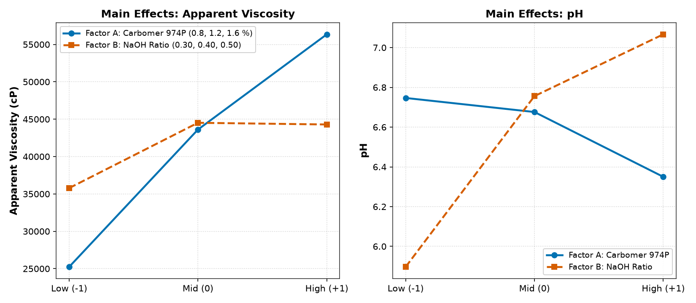
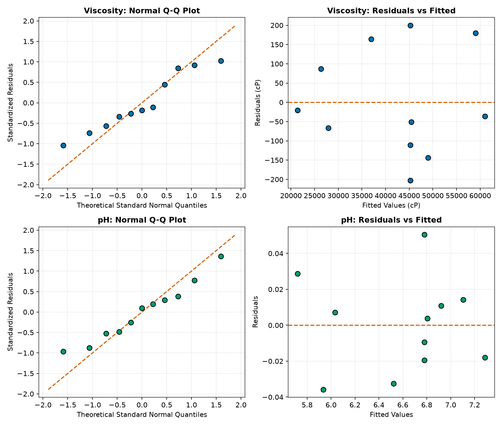
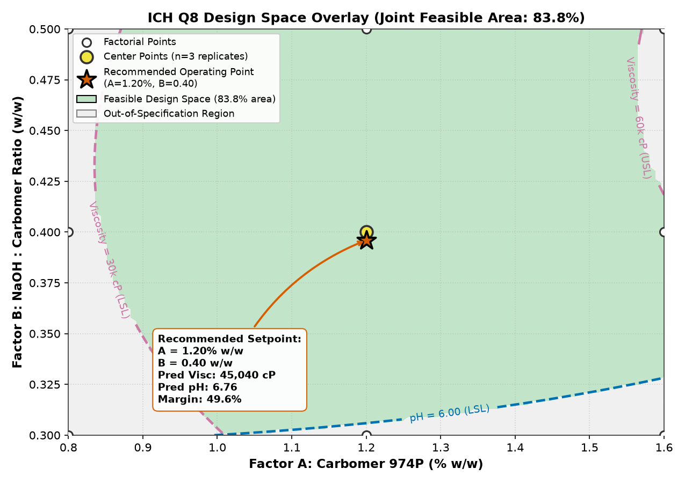
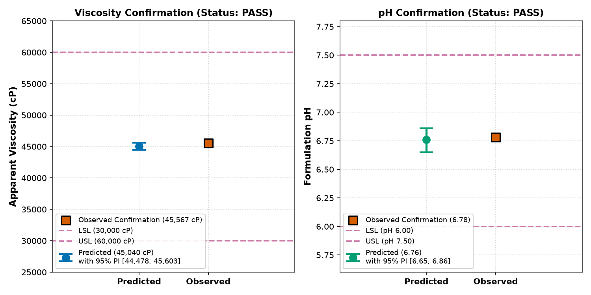

# Quality by Design (QbD) Design Space: Risk-Based Formulation Optimization, Response Surface Methodology & ANOVA

[](LICENSE)
[](https://www.python.org/)
[%20%7C%20ICH%20Q9-orange.svg)](https://database.ich.org/sites/default/files/Q8_R2_Guideline.pdf)
[](#)

> **Headline Result:** A 3×3 full factorial response surface with 3 center-point replicates ($n=11$) established a multi-attribute ICH Q8 design space covering **83.78%** of the factor domain. Ordinary least squares (OLS) regression demonstrated strong predictive fit for Apparent Viscosity ($R^2 = 0.9999$, Lack-of-Fit $p = 0.6136$) and pH ($R^2 = 0.9973$, Lack-of-Fit $p = 0.5540$). A robust operating setpoint at **1.20% w/w Carbomer 974P** and **0.40 w/w NaOH:Carbomer ratio** provided a **49.62% safety margin** to specification boundaries and was validated via an independent confirmation run meeting both 95% prediction intervals.

---

## 1. Case Background & QbD Context

Under **ICH Q8(R2) Pharmaceutical Development**, quality cannot be tested into a drug product; it must be designed into the formulation and manufacturing process. Traditional "one-factor-at-a-time" (OFAT) experimentation fails to detect non-linear interactions and cannot quantify process robustness.

This case study models the formulation optimization of a **Model Oral Bioadhesive Gel** (500 g laboratory batch). The formulation relies on cross-linked polyacrylic acid (Carbomer 974P) neutralized in situ with sodium hydroxide to form a clear, high-yield hydrogel matrix.

### Quality Target Product Profile (QTPP) & Critical Quality Attributes (CQAs)

| QTPP Element | Target Criterion | Critical Quality Attribute (CQA) | Acceptance Criterion | Analytical Method |
| :--- | :--- | :--- | :--- | :--- |
| **Physical Appearance** | Clear, homogeneous gel | Phase stability | No syneresis, aeration, or phase separation | Visual inspection (25 °C) |
| **Mucosal Bioadhesion & Flow** | Retains on oral mucosa; dispensable from oral syringe | **Apparent Viscosity** | **30,000 – 60,000 cP** | Brookfield RV, Spindle 6, 10 rpm, 25 °C |
| **Physiological Compatibility** | Non-irritating to oral mucosa; stable preservative efficacy | **Formulation pH** | **6.00 – 7.50** | Calibrated potentiometric pH probe (25 °C) |
| **Microbial Quality** | Ph. Eur. / USP non-sterile oral criteria | Bioburden | TAMC $\le 10^2$ CFU/g, TYMC $\le 10^1$ CFU/g | USP <61> / <62> |

---

## 2. Risk Assessment (ICH Q9 FMEA)

Prior to experimental design, four candidate variables were evaluated using Failure Mode and Effects Analysis (FMEA). Severity ($S$), Occurrence ($O$), and Detection ($D$) were scored on a 1–5 scale, yielding the Risk Priority Number ($\text{RPN} = S \times O \times D$). The risk threshold was set at $\text{RPN} \ge 30$.

| Factor | Factor Role | Potential Failure Mode | S | O | D | RPN | Disposition / Control Strategy |
| :--- | :--- | :--- | :---: | :---: | :---: | :---: | :--- |
| **Carbomer 974P % w/w** | Gelling & bioadhesive polymer | Viscosity collapse ($<30\text{k}$ cP) or excessive stiffness ($>60\text{k}$ cP) impairing dispensing | 5 | 4 | 4 | **80** | **Selected for DoE (Factor A: 0.80% – 1.60% w/w)** |
| **NaOH : Carbomer Ratio (w/w)** | Neutralizing base | Under-neutralization causes acidity and incomplete uncoiling; excess causes counter-ion shielding | 5 | 4 | 4 | **80** | **Selected for DoE (Factor B: 0.30 – 0.50 w/w)** |
| **Mixing Speed (rpm)** | Dispersion shear | Vortex aeration and air bubble entrapment at high shear; incomplete hydration at low shear | 3 | 2 | 2 | **12** | **Fixed Process Control (800 rpm)** |
| **Glycerol % w/w** | Humectant & co-solvent | Tackiness deviation or phase syneresis | 3 | 2 | 2 | **12** | **Fixed Formulation Control (20.0% w/w)** |

**Process Control Fixation:** Agitation was fixed at 800 rpm with a marine impeller to guarantee complete polymer wetting without introducing micro-aeration. Glycerol was held at 20.0% w/w based on pre-formulation stability data.

---

## 3. Experimental Design: 3×3 Factorial with Center Points

The study employed a $3 \times 3$ full factorial design ($3^2 = 9$ factor combinations) augmented with 3 center-point replicates ($n=11$ total runs).

### Factor Levels
- **Factor A (Carbomer 974P):** Low = 0.80%, Center = 1.20%, High = 1.60% w/w.
- **Factor B (NaOH : Carbomer Ratio):** Low = 0.30, Center = 0.40, High = 0.50 w/w.

```
       NaOH : Carbomer Ratio (B)
             0.30      0.40      0.50
          +---------+---------+---------+
   1.60%  | Run 7   | Run 8   | Run 9   |   Factorial Points: n = 8
Carbomer  +---------+---------+---------+
   1.20%  | Run 4   | Runs 5, | Run 6   |   Center Points:    n = 3 (Replicates)
          |         | 10, 11  |         |
          +---------+---------+---------+
   0.80%  | Run 1   | Run 2   | Run 3   |   Total Runs:       n = 11
          +---------+---------+---------+
```

### Raw Data Ingestion & Data Quality Audit
Prior to model fitting, raw electronic acquisition files (`data/runs_raw.csv`) were audited:
- **Detected Anomalies:** 1 accidental duplicate entry (operator recording error) and 1 incomplete record with sensor dropout.
- **Audit Action:** Anomalies rejected; clean 11-run matrix persisted into `data/doe.db` (SQLite) and documented in `out/data_audit_report.json`.

---

## 4. Response Surface Modeling & ANOVA

Second-order polynomial equations were fitted using Ordinary Least Squares (OLS) implemented natively in NumPy/SciPy without black-box dependencies:

$$\hat{y} = \beta_0 + \beta_1 A + \beta_2 B + \beta_{12} AB + \beta_{11} A^2 + \beta_{22} B^2$$

### ANOVA Summary Table

| Response | Source | DF | Sum of Squares (SS) | Mean Square (MS) | F-value | p-value | Interpretation |
| :--- | :--- | :---: | :---: | :---: | :---: | :---: | :--- |
| **Apparent Viscosity** | **Model** | **5** | **1,636,209,342** | **327,241,868** | **8,636.0** | **$< 0.0001$** | **Statistically Significant** |
| ($R^2 = 0.9999$) | Linear ($A, B$) | 2 | 1,561,018,871 | 780,509,436 | 20,597.7 | $< 0.0001$ | Primary driving terms |
| ($\text{Adj-}R^2 = 0.9998$) | Interaction ($AB$) | 1 | 12,673,956 | 12,673,956 | 334.5 | $< 0.0001$ | Significant curvature synergy |
| | Quadratic ($A^2, B^2$) | 2 | 62,516,514 | 31,258,257 | 824.9 | $< 0.0001$ | Polymer saturation curvature |
| | **Residual Error** | **5** | **189,465** | **37,893** | — | — | — |
| | Lack-of-Fit | 3 | 100,508 | 33,503 | 0.753 | **0.6136** | **Not Significant (Adequate Model)** |
| | Pure Error | 2 | 88,956 | 44,478 | — | — | Baseline experimental noise |
| | Total | 10 | 1,636,398,806 | — | — | — | — |
| **Formulation pH** | **Model** | **5** | **2.5106** | **0.5021** | **364.5** | **$< 0.0001$** | **Statistically Significant** |
| ($R^2 = 0.9973$) | Linear ($A, B$) | 2 | 2.2894 | 1.1447 | 831.0 | $< 0.0001$ | Base ratio dominant |
| ($\text{Adj-}R^2 = 0.9945$) | Interaction ($AB$) | 1 | 0.0072 | 0.0072 | 5.25 | 0.0706 | Marginal interaction |
| | Quadratic ($A^2, B^2$) | 2 | 0.2140 | 0.1070 | 77.7 | 0.0002 | Plateauing neutralization curve |
| | **Residual Error** | **5** | **0.0069** | **0.0014** | — | — | — |
| | Lack-of-Fit | 3 | 0.0040 | 0.0013 | 0.935 | **0.5540** | **Not Significant (Adequate Model)** |
| | Pure Error | 2 | 0.0029 | 0.0014 | — | — | Baseline potentiometric noise |
| | Total | 10 | 2.5175 | — | — | — | — |

**Lack-of-Fit Proof:** For both responses, the Lack-of-Fit $p$-value exceeds 0.05 ($p=0.6136$ and $p=0.5540$), demonstrating that the residual variation is statistically indistinguishable from pure replication noise.

---

## 5. Decision-Grade Engineering Figures

### Factor Effects & Physical Chemistry Insights

*Figure 1: Main effect plots for Apparent Viscosity (left) and pH (right) across factor levels.*

- **Viscosity Mechanism:** Increasing Carbomer 974P increases viscosity near-linearly. Increasing the neutralization ratio raises viscosity up to an optimum ($\approx 0.40 - 0.45$), beyond which excess $Na^+$ counter-ions compress the electrical double layer and shield carboxylate charges, resulting in a plateau.
- **pH Mechanism:** Controlled primarily by the stoichiometric NaOH:Carbomer ratio, with Carbomer mass concentration having a mild buffering effect.

---

### Statistical Diagnostics

*Figure 2: Residual diagnostics showing normal Q-Q plots (theoretical quantiles vs. standardized residuals) and residuals vs. fitted values for both responses.*

---

### ICH Q8 Multi-Attribute Design Space Overlay
The design space represents the intersection of the two CQA criteria:
1. $30,000 \text{ cP} \le \hat{y}_{\text{visc}} \le 60,000 \text{ cP}$
2. $6.00 \le \hat{y}_{\text{pH}} \le 7.50$


*Figure 3: Multi-attribute Design Space overlay. Green region denotes the joint feasible space (83.78% of domain). Star indicates the recommended operating point.*

---

## 6. Optimization & Confirmation Run

### Robust Operating Point
The optimal setpoint maximizes the minimum normalized distance to any specification boundary:

$$\max_{A, B} \left[ \min \left( \frac{\hat{y}_v - 30000}{30000}, \frac{60000 - \hat{y}_v}{30000}, \frac{\hat{y}_p - 6.00}{1.50}, \frac{7.50 - \hat{y}_p}{1.50} \right) \right]$$

- **Recommended Carbomer 974P:** **1.20% w/w**
- **Recommended NaOH : Carbomer Ratio:** **0.40 w/w** (0.396)
- **Predicted Viscosity:** **45,040.3 cP** (49.87% margin to bounds)
- **Predicted pH:** **6.76** (49.62% margin to bounds)

### Confirmation Batch Results (95% Prediction Intervals)
An independent synthetic confirmation batch was evaluated at the recommended setpoint. Prediction intervals (accounting for both model parameter variance and individual batch error) were computed:

$$\text{PI}_{95\%} = \hat{y}_0 \pm t_{0.025, \, df=5} \cdot s \sqrt{1 + \mathbf{x}_0^T (\mathbf{X}^T \mathbf{X})^{-1} \mathbf{x}_0}$$


*Figure 4: Confirmation run observed values compared against predicted setpoints, 95% prediction intervals, and CQA specification limits.*

| Response | CQA Specification | Model Prediction | 95% Prediction Interval | Observed Run | Conformance | Status |
| :--- | :---: | :---: | :---: | :---: | :---: | :---: |
| **Apparent Viscosity** | 30,000 – 60,000 cP | 45,040 cP | [44,478, 45,603] cP | **45,567 cP** | Inside PI & Spec | **PASS** |
| **Formulation pH** | 6.00 – 7.50 | 6.76 | [6.65, 6.86] | **6.78** | Inside PI & Spec | **PASS** |

---

## 7. Recommended Control Strategy

Based on the validated design space, the following commercial manufacturing control strategy is established:

1. **Input Material Specifications:**
   - Carbomer 974P: Dispense $1.20\% \pm 0.05\%$ w/w of batch mass.
   - Neutralizing Solution: Dispense 10.0% w/v NaOH solution to deliver an active ratio of $0.40 \pm 0.02$ g NaOH / g Carbomer.
2. **In-Process Controls (IPCs):**
   - Agitation speed: $800 \pm 50$ rpm for 45 minutes hydration.
   - Batch temperature: $25.0 \pm 2.0$ °C during neutralization.
3. **Regulatory Flexibility (ICH Q8):**
   - Movement within the green design space ($A \in [1.05\%, 1.45\%]$, $B \in [0.35, 0.47]$) does not constitute a post-approval regulatory change and does not require regulatory notification.

---

## 8. Reproducibility & Pipeline Usage

### Requirements
- Python 3.10+
- Dependencies: `numpy`, `pandas`, `scipy`, `matplotlib`, `nbformat`, `nbclient`

### Quick Start
```bash
git clone https://github.com/xikass/qbd-doe-design-space.git
cd qbd-doe-design-space

# Install dependencies
pip install -r requirements.txt

# Run complete pipeline (data -> analysis -> test -> notebook)
make all
```

### Makefile Targets
```bash
make data       # Generate FMEA, synthetic runs, raw artifacts, and SQLite database
make analysis   # Run OLS, ANOVA, design space optimization, and charts
make test       # Execute test suite (tests/selfcheck.py)
make notebook   # Execute analysis.ipynb in-place with outputs
make clean      # Clean output artifacts
```

### Repository File Structure
```
qbd-doe-design-space/
├── Makefile                        # Unified build and test automation
├── README.md                       # Case study documentation
├── LICENSE                         # MIT License
├── requirements.txt                # Pinned dependencies
├── analysis.ipynb                  # Executed interactive notebook with outputs
├── analysis.py                     # Master orchestration script
├── data/
│   ├── doe.db                      # Authoritative SQLite database (runs, fmea)
│   ├── runs.csv                    # Clean experimental runs (n=11)
│   ├── runs_raw.csv                # Raw acquisition records with dirty artifacts
│   └── fmea.csv                    # ICH Q9 risk matrix
├── sql/
│   ├── design_matrix.sql           # Query runs with replicate counts & cell stats
│   └── anova_inputs.sql            # Pure error calculation query
├── src/
│   ├── __init__.py
│   ├── generate_data.py            # Data generator & raw record auditor
│   ├── anova.py                    # Native OLS regression & ANOVA decomposition
│   ├── design_space.py             # Design space grid, optimizer & confirmation engine
│   └── charts.py                   # Matplotlib publication figures (DPI=150)
├── charts/                         # 7 Generated decision-grade charts (>10 KB each)
├── out/
│   ├── results.json                # Complete machine-readable results summary
│   ├── data_audit_report.json      # GxP raw data audit log
│   ├── anova_viscosity.csv         # Full ANOVA table for viscosity
│   ├── anova_ph.csv                # Full ANOVA table for pH
│   └── design_space_grid.csv       # Feasibility evaluation across 10,201 grid points
└── tests/
    ├── __init__.py
    └── selfcheck.py                # Automated assertion suite
```

---

## 9. Data Confidentiality & Scope Note

All formulations, batch records, factor ranges, and experimental observations presented in this repository are **100% synthetic**. Data was generated deterministically using mathematical polymer rheology models with seeded Gaussian error to demonstrate QbD methodology without disclosing proprietary pharmaceutical formulations, commercial trade secrets, or employer data.

---

## 10. Limitations & Future Development

1. **Viscoelastic Rheology:** Apparent viscosity is modeled at a single shear rate (10 rpm, Spindle 6). Physical carbomer hydrogels exhibit non-Newtonian pseudoplastic shear-thinning; future iterations should incorporate yield-stress and flow-index ($n$) response surfaces.
2. **Scale-Down vs. Commercial Scale:** Impeller tip speed ($\pi D N$) and power consumption per unit volume ($P/V$) must be scaled geometrically when translating from 500 g laboratory vessels to commercial 500 kg manufacturing tanks.

---

## About the Author

**Mohammad A. Zachariah**  
Pharmaceutical R&D Formulator & Operations Systems Developer  
- **LinkedIn:** [https://www.linkedin.com/in/mo-zachariah](https://www.linkedin.com/in/mo-zachariah)

### Related Open-Source Case Studies
- [**mrp-shortage-prioritization**](https://github.com/xikass/mrp-shortage-prioritization): Risk-based raw material MRP shortage allocation engine under supply chain constraints.
- [**cogs-margin-analysis**](https://github.com/xikass/cogs-margin-analysis): Pharmaceutical cost of goods sold (COGS) and unit gross margin sensitivity modeling.

---

## License

This project is licensed under the MIT License — see the [LICENSE](LICENSE) file for details.
